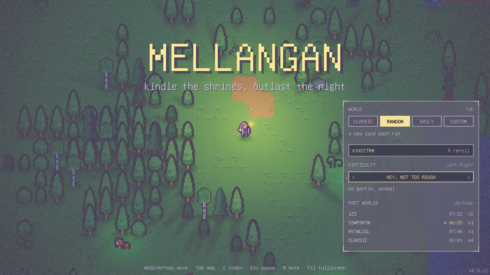
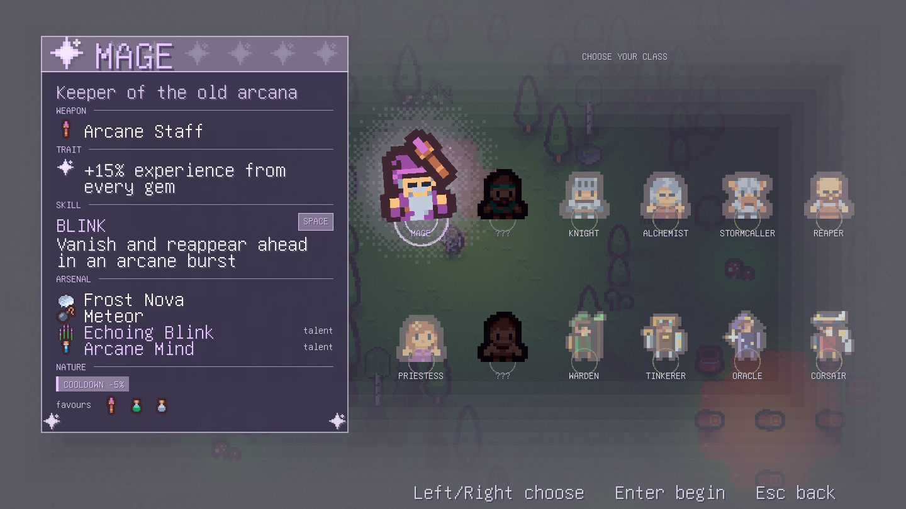
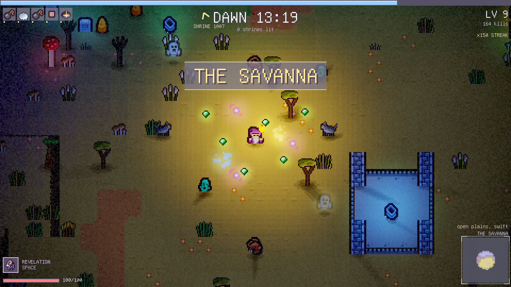
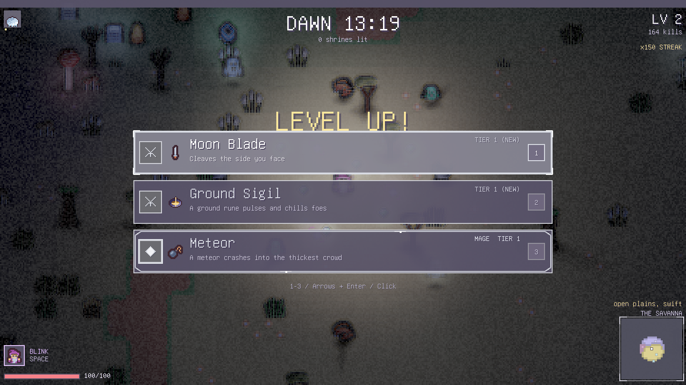

# Mellangan

Linux support is coming. macOS on Apple Silicon builds as a native app.

The programming paradigm is "C with classes": that means the game is written in C++20 and might feel like C++ but the code is structured to use C idioms.

The name was a random headbash against the keyboard and stands for: nothing


A yet small top-down "v-survivors"-like game built with C++20 on the [Vulkan2D](https://github.com/soulwax/Vulkan2D) renderer,
using [EnTT](https://github.com/skypjack/entt) for entity storage and [spdlog](https://github.com/gabime/spdlog) for logging.

Survive the night against a horde of enemies blabla, but with the catch that you need to traverse the biomes to find shrines to light and kindle them to win the run. The enemies are a mix of melee and ranged, and the player can pick up upgrades to help them survive.
Enemies can have their own type of attacks, upgrades, passives and abilities.
-
## Screenshots

| Title screen | Class selection |
| --- | --- |
| [](static/screenshots/01-title.png) | [](static/screenshots/02-classes.png) |
| Combat and exploration | Upgrades |
| [](static/screenshots/03-combat.png) | [](static/screenshots/04-upgrades.png) |

## Building

Requires CMake 3.21+, a C++20 compiler (MSVC on Windows, GCC 11+ or Clang 14+ on Linux), and the
[Vulkan SDK](https://vulkan.lunarg.com/) for its `slangc` shader compiler. SDL is built from the submodule and linked
statically.

```sh
git clone --recurse-submodules git@github.com:soulwax/Mellangan.git
cmake -S . -B build
cmake --build build --config Release
```

Shaders in `res/shaders` are compiled to SPIR-V at build time with the SDK's `slangc`, so Vulkan2D's
runtime Slang compiler is disabled and never built. The executable lands next to a copy of `res/`.

### Windows

If `VULKAN_SDK` is not set, CMake picks the newest install under `C:/VulkanSDK`. The executable is
`build/Release/Mellangan.exe`.

### Linux

Install a compiler, CMake, Ninja or Make, and SDL's build dependencies for X11, Wayland and audio. On Debian or Ubuntu:

```sh
sudo apt install build-essential cmake ninja-build pkg-config libx11-dev libxext-dev libxrandr-dev libxcursor-dev   libxi-dev libxss-dev libxtst-dev libwayland-dev libxkbcommon-dev wayland-protocols libegl-dev   libasound2-dev libpulse-dev libpipewire-0.3-dev libdbus-1-dev libudev-dev libvulkan-dev
```

On Arch: `sudo pacman -S base-devel cmake ninja libx11 libxext libxrandr libxcursor libxi libxss libxtst wayland
libxkbcommon wayland-protocols alsa-lib libpulse pipewire dbus systemd-libs vulkan-icd-loader vulkan-headers`.

Download the LunarG Vulkan SDK tarball for Linux, extract it, and source its environment so `VULKAN_SDK` and
`slangc` are set before configuring:

```sh
source ~/vulkansdk/<version>/setup-env.sh
cmake -S . -B build -G Ninja
cmake --build build
./build/Mellangan
```

Single-config generators default to a Release build. Players need a Vulkan driver (Mesa or the GPU vendor's).
Crashes log a backtrace to `mellangan.log` next to the executable.

### macOS (Apple Silicon)

Install the Xcode command line tools (`xcode-select --install`) and [Homebrew](https://brew.sh), then run
`./setup-macos.sh`. It installs CMake, Ninja, the Vulkan headers and loader, MoltenVK, the validation layers and
`vulkaninfo` from Homebrew, registers the validation layer under `~/.config/vulkan`, and downloads pinned,
checksummed `slangc` and MoltenVK releases into the ignored `build-deps/` folder, where CMake finds them. Then:

```sh
cmake -S . -B build-macos -G Ninja -DCMAKE_BUILD_TYPE=Debug -DCMAKE_OSX_ARCHITECTURES=arm64
cmake --build build-macos
open build-macos/bin/Mellangan.app
```

The result is a self-contained `Mellangan.app` for macOS 12 or newer: it links and embeds MoltenVK, loads assets
from `Contents/Resources/res`, and needs no Vulkan SDK or environment variables. Run
`build-macos/bin/Mellangan.app/Contents/MacOS/Mellangan --test` for the test suite. The log, `vk2derror.txt`,
saves and the Codex live in `~/Library/Application Support/soulwax/Mellangan/`.

For Vulkan validation during development, configure a second tree with `-DMELLANGAN_VULKAN_LOADER=ON`; it links
Homebrew's loader instead of embedding MoltenVK, so that build only runs on the machine that built it. Do not set
`VK_ICD_FILENAMES` to Homebrew's mock driver; `vulkaninfo --summary` should list your Apple GPU with MoltenVK.
`./dist.sh` on a Mac packages `dist/Mellangan-<version>-macos-arm64.zip`: a Release `Mellangan.app` with only the
shipped assets, arm64 MoltenVK, a dependency check and an ad hoc signature, plus a `.sha256`.

The macOS download is not notarized yet. After unzipping, macOS refuses the first launch; open System Settings →
Privacy & Security and choose **Open Anyway** for Mellangan, or run `xattr -dr com.apple.quarantine Mellangan.app`.

## Releasing

The version lives in `VERSION` (`MAJOR.MINOR.PATCH`) and every release needs notes under `## [Unreleased]` in
`CHANGELOG.md`. Then run, on Windows or Linux, with PowerShell 7 (`pwsh`; on Windows 7-Zip must be on PATH or
installed):

```powershell
./dist.ps1             # patch bump: 0.1.0 -> 0.1.1
./dist.ps1 -Bump minor # 0.1.1 -> 0.2.0
./dist.ps1 -Bump none  # rebuild the current version, changelog untouched
```

It bumps `VERSION`, dates the changelog section, builds Release, and writes `dist/Mellangan-<version>-windows.7z` or
`dist/Mellangan-<version>-linux.tar.gz` containing the executable, `res/`, and the changelog. To package the other
platform's build of the same version, run `./dist.ps1 -Bump none` there. SDL and, on Windows, the CRT are linked
statically, so players only need a Vulkan-capable driver.
If the build fails, `VERSION` and `CHANGELOG.md` are restored.

On Linux and macOS, `./dist.sh` does the same in bash (`./dist.sh minor`, `./dist.sh none`) and writes
`dist/Mellangan-<version>-<linux|macos>.tar.gz` with a `.sha256` beside it. On macOS it bundles the Vulkan loader and
MoltenVK from `$VULKAN_SDK` into `lib/`; players start the game with `Mellangan.command`.

## Controls

Combat supports four timed afflictions. Burn and poison deal damage every half second; chill slows movement;
marked increases damage from direct hits. Reapplying a status keeps its strongest potency and extends its
remaining duration when the new application lasts longer. Frost Nova chills enemies by 35% for two seconds,
and fire pools leave a short burn when enemies move away. Afflictions clear on death or revival.

| Key | Action |
| --- | --- |
| WASD / Arrows | Move |
| Space | Class skill |
| 1-4, Arrows + Enter, Mouse | Pick an upgrade (4 for a relic) |
| Tab | World map (arrows pan, 1-3 zoom); on the title, switch world mode |
| Up / Down (title) | Recall a past world |
| Left / Right (class screen) | Choose a class |
| C (title, pause) | Codex |
| Esc / P | Pause |
| F11 | Fullscreen |
| F3 | FPS counter |
| V | Toggle full or reduced cosmetic particles (also available while paused) |
| I | Inventory; beside a merchant, workbench, stash, elder or waypoint it opens theirs instead |
| Alt (hold) | Show the names of items on the ground |
| K (title) | Begin or continue the campaign |
| K (campaign) | Skill tree |
| R (campaign class screen) | Toggle Hardcore |
| E (campaign) | Strike a tree, rock or crystal (hold to keep striking), relight a dead torch, take down something you built, or delve into a mine |
| B (campaign) | Build a campfire, torch, fence, stone wall or workbench |

Enemy attack warnings use red markers, including directional melee windups and hostile projectiles.
Burn, chill, poison, and marked effects have distinct icons and player HUD timers. Reduced particles hides
some cosmetic sparks and debris while keeping gameplay indicators and damage numbers visible; the setting
is remembered between sessions.

### Campaign

Press K on the title screen to start a campaign. One hero lives in one world across sessions,
starting in Hearthwick, a bastion its people refuse to let be overrun: its fence is sealed but for
one bridge, held by knights, and inside are a waypoint, a stash, a merchant and Elder Maren.
Days and nights repeat, and foes grow stronger the further you roam from town.

- **Acts.** Five acts, each with four quests and an act boss. Clearing an act opens the road to the
  next act's town; waypoints travel between the towns you have reached.
- **Skill tree.** Levelling up gives skill points for the Arms, Arts and Instincts tabs.
- **Gathering and building.** Trees, rocks, crystals and flowers give materials. Campfires,
  torches, fences, walls and workbenches can be built from them, and lights keep most foes from
  spawning nearby. At night, shades come to put the lights out.
- **Delves.** A mine seals you in for three floors of underground foes and the act's guardian boss.
- **Saving.** The waypoint saves, as do a timer, the stash and quitting. Falling wakes you at the
  waypoint or your nearest campfire for a tenth of your gold; Hardcore heroes get one life.
- **Nightmare.** After the last act, the acts begin again with every foe stronger.

Run with `--bench` to log performance at 100 to 50,000 enemies (the game quits when it is done).

## Layout

Biome climate fields are stretched to 2.5 times their previous width. Ground materials and vegetation mix over
a four-tile sampling radius at biome borders, while structures, dirt paths, lava, and oasis water keep their
local shapes. Seeds remain deterministic; this generation change relocates biome boundaries. Old explored
charts retain their explored area and refresh biome colours and structure markers when loaded.

Familiar climates are concentrated near the spawn at the world origin. Exotic regions become more likely
from roughly 100 to 450 tiles away, with the full biome distribution beyond that distance. Existing explored
charts refresh their biome colours and structure markers when loaded under the new generation.

Some structures start a biome challenge: defeat the local guards and complete the indicated objective to earn
a treasure chest, experience, and a biome-themed bonus for the rest of the run. Exotic biome bonuses are twice
as strong. Leaving the challenge area, running out of time, or losing a guard fails the challenge.

Debug `--test` includes seeded biome-spacing and transition checks. To export a before/after map on Windows:

```powershell
$env:MELLANGAN_BIOME_PREVIEW = 'build/biome-transitions.csv'
./build/bin/Debug/MellanganApp.exe --test
uv run --with pillow tools/biome_transition_preview.py build/biome-transitions.csv build/biome-transitions.png
```

`./build/bin/Debug/MellanganApp.exe --test-biome-view 179 -142 0` opens a temporary rendered boundary view
at tile `(179, -142)` with noise seed `0`, then exits after 20 seconds. It does not load or save player progress.
`./build/bin/Debug/MellanganApp.exe --test-effects-view` shows a temporary, repeating enemy death and warning
effects scene without loading or saving player progress.
`./build/bin/Debug/MellanganApp.exe --test-gui-view` previews the level-up and shrine menus without saving progress.
`./build/bin/Debug/MellanganApp.exe --test-encounter-view` previews a biome challenge without saving progress.
`./build/bin/Debug/MellanganApp.exe --test-combat-view` previews combat indicators; V switches particle detail.
`./build/bin/Debug/MellanganApp.exe --test-arsenal-view` shows the Mage with every recipe weapon at tier 5 against waves of foes and cycles its five skills; 1-5 casts one.
`./build/bin/Release/MellanganApp.exe --capture-screenshots` captures the 1440x810 screenshot suite into `static/screenshots/`.

- `src/SpriteObject.hpp` – root of everything in the world: position, velocity, pixel position and a sprite
- `src/entity` – `SpriteObject` → `Entity` → `Mob` → `Player` / `Enemy` (`Bat`, `Ghost`, `Cyclops`), projectiles, pickups, and `Pool.c`
  (slab allocator for entities)
- `src/entity/enemy/ai` – goal queue AI: `Goal`, the goals (`LookOut`, `Approach`, `Stalk`, `Follow`, `Melee`, `Ranged`,
  `Hide`) and a plan per enemy kind; `src/Workers` runs it on a thread pool
- `src/particle` – particles kept outside the registry in `Level::particles`: `Spark` and `TextParticle`, and `Debris` after dittany: blood, meat, smoke, flames, heal crosses and
  the `Explosion` emitter
- `src/item` – `Upgrade` and its weapons, passives, relics, talents and drafted skills (`item/skill`: the `Skill`
  base, `MageSkills` and the `Arts` table of class and general skills)
- `src/item/weapon/Recipe` – data-driven weapons (`RecipeShot` lives in `form/RecipeShot.cpp`; `castRecipe` fires a
  recipe at its own damage, reach and count): `RECIPES` lists each weapon as one entry, `RecipeWeapon` levels and
  fires it, and `RecipeShot` holds the shared hit, status, blast and chain mechanics; `item/weapon/form` has one
  `FormBehavior` class per `Form` (bolt, volley, seeker, boomerang, orbit, nova, rain, field, cleave, lob, trap, beam)
  deciding how a shot is fired, moves, draws and lights. A new form is a new class plus a line in `FormBehavior::of`
- `src/hero` – one class per hero (`Mage`, `Ranger`, … `Corsair`); the four expansion heroes share `ExpansionHero`
  for their sprite
- `src/entity/ability` – the shared ability catalogue (`entity/Ability.hpp`) used by heroes, skills and foes, grouped as
  `Strikes`, `Barrages`, `Control` and `Support`; `Common.hpp` holds their private helpers
- `src/entity/enemy` – `Enemy` (AI, movement, hits, drawing), `Roster` (stats table, names, the `create` factory),
  `Rank` (elites, champions, bosses and their casting) and `EnemyDeath` (death, loot and death effects)
- `src/level` – `Level` (backed by an `entt::registry`; `Level.cpp` lifecycle and world tick, `LevelRender.cpp` props,
  draw order, reflections and light, `FloorPainter` the ground, blends, puddles, snow and cliffs, `Prop::shine` prop light, `LevelSpace.cpp` collision, heights and spatial queries) and the
  `Spawner` (one method per schedule: trickle, horde, mimics, renegades, champions, barrels, bosses); `Level::quake`
  hurts every foe in a radius and `world::biomeUnder` maps a pixel position to its biome; world generation as small table-driven
  modules: `Noise.c` (pure C Perlin/fBm), `Biome`, `Feature` (scattered props), `Structure` (layouts) and
  `Encounter` (what a structure does when entered; the table, with `level/encounter` holding `Sites`, `Landmarks` and
  their shared helpers); `level/world` implements `World.hpp` as `Biomes` (tile memo,
  biome votes, ground blend), `Terrain` (height, water, dirt, ramps), `Sites` (structure rolls), `Ground` (floor
  tiles, shade, tint) and `Props`, sharing `Internal.hpp`; `level/structure` holds the layouts behind the
  `STRUCTURES` table (`Settlements`, `Wilds`, `Landmarks`); `Prop::piece`, `body`, `lamp` and `fire` set a prop's
  sprite, collider and light in one call
- `src/level/Sky` – weather simulation and its queries; `level/sky` has the front table (`Fronts`), `Footprints`,
  `Thunder` and the drawing (`SkyRender`)
- `src/level/BiomeReward`, `EncounterGuards`, and `EncounterObjective` – biome challenge rewards, local guard
  tracking, and objective rules used by the encounter lifecycle
- `src/menu` – title, pause, level-up, and death menus; `HeroCard` and `HeroSigil` draw the class menu's info card
  and sigils, `UpgradeCard` draws one level-up choice
- `src/gui` – reusable GUI widgets and shared choice layout and input handling, `Glyph` (pixel-art glyphs from
  string rows) and `Text` (word wrap); `Hud` draws the in-run HUD (bars,
  timers, icons, minimap, edge pointers to shrines, landmarks and champions, one method per panel with shared
  `arrow`, `diamond` and `tag` pointer helpers) and owns the announcement banners
- `src/Game` – the run loop, menus and run lifecycle; `gfx/Camera` follows, shakes and aims the view; `src/meta/Saves` owns the preference folder, world
  choice and world history files; `src/DevStart` parses the dev start flags (`--arm`, `--hero`, `--biome`, `--at`,
  `--lake`, `--cliff`, `--ramp`, `--peak`, `--landmark`) and places and arms the player
- `src/test` – the `--test` suite split by area (`CoreTest`, `CombatTest`, `ClassTest`, `RunTest`, `WorldTest`,
  biome, expansion and arsenal tests; `Tests.hpp` lists them) and `src/test/view` – the `--test-*-view` QA scenes,
  `--biome-map` and `--capture-screenshots` (`Views.hpp`); `main.cpp` maps each flag to its view in one table
- `src/gfx` – `Screen`, the thin layer over Vulkan2D
- `res/shaders` – `post.slang` (lighting composite, bloom, tonemap, damage feedback) and `flash.slang` (hit flash)
- `tools/make_assets.py` – rebuilds `res/atlas.png` from the Kenney sheet plus generated FX sprites
- `tools/sprite_kit.py`, `tools/make_sprites.py` – procedural pixel painter and the sprite-kit band (trees, shrubs, rocks, tufts); `--preview` renders a catalogue
- `tools/make_grounds.py` – carpet ground sets (straw, ash, crystal moss, mycelium, lava) for `Carpet` biomes
- `tools/make_flora.py`, `tools/make_desert.py` – add the recoloured and hand-drawn plants, mud, sand and water tiles to `res/atlas.png`
- `tools/make_winter.py` – adds the frosted winter band to `res/atlas.png` (also run by `make_assets.py`)
- `tools/make_arsenal.py` – paints recipe weapon and skill icons into the arsenal band (chained by `make_expansion.py` and `make_assets.py`); `--preview out.png` writes them at 8x
- `tools/biome_viewer` – standalone `BiomeViewer` window showing the whole generated world (biome colours shaded by
  height, water, structure sites) for a seed. Build it on demand with `cmake --build build --target BiomeViewer`
  (Release is about six times faster). Refresh or R rolls a new seed, 0 shows the classic world, +/- or the wheel
  zoom from 1 to 32 tiles per pixel, C copies the map to the clipboard as PNG, S saves `biomes-<seed>-x<zoom>.png`,
  T toggles structure dots, and hovering shows the biome and height under the cursor.
  `BiomeViewer [--seed HEX] --png out.png` writes one map without a window
- `tools/footprint_preview.py` – composes a dumped structure footprint (ground and props) into a preview PNG
- `tools/building_preview.py` – composes Tiny Town tile rows into a preview PNG, used to design buildings outside the game

See `res/CREDITS.md` for asset licenses.
